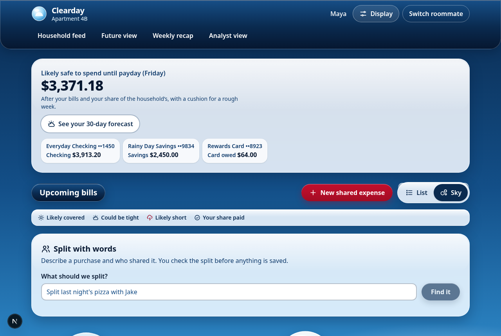
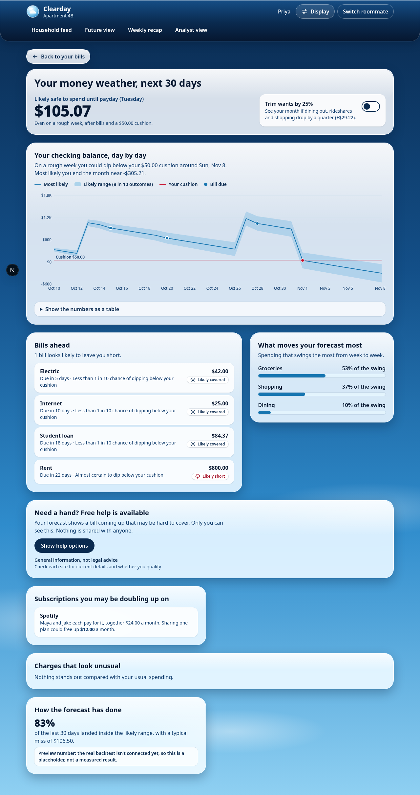
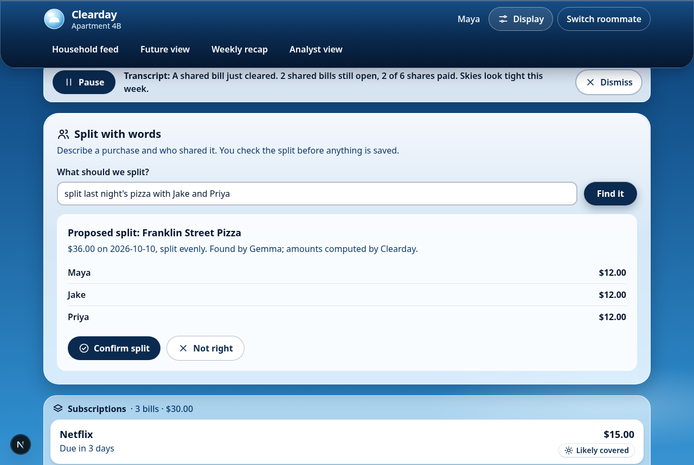
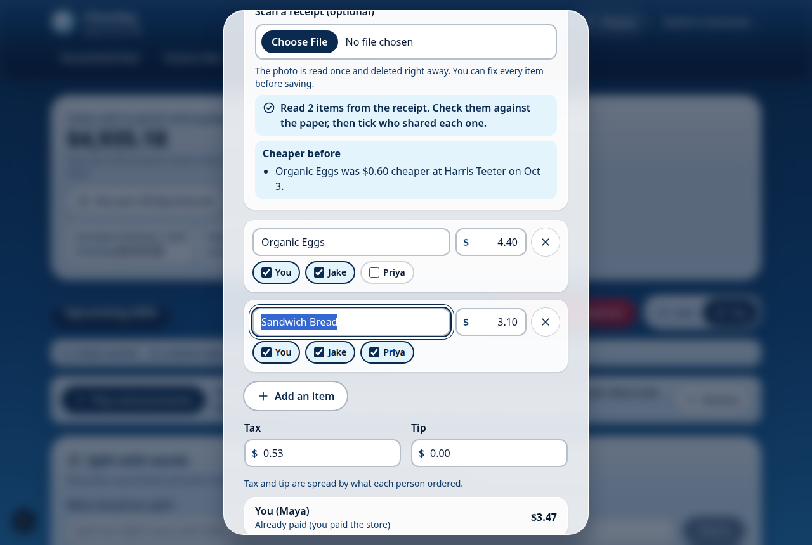
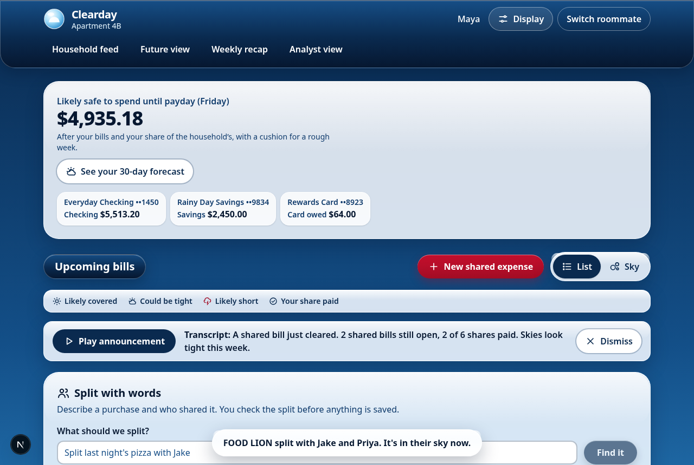
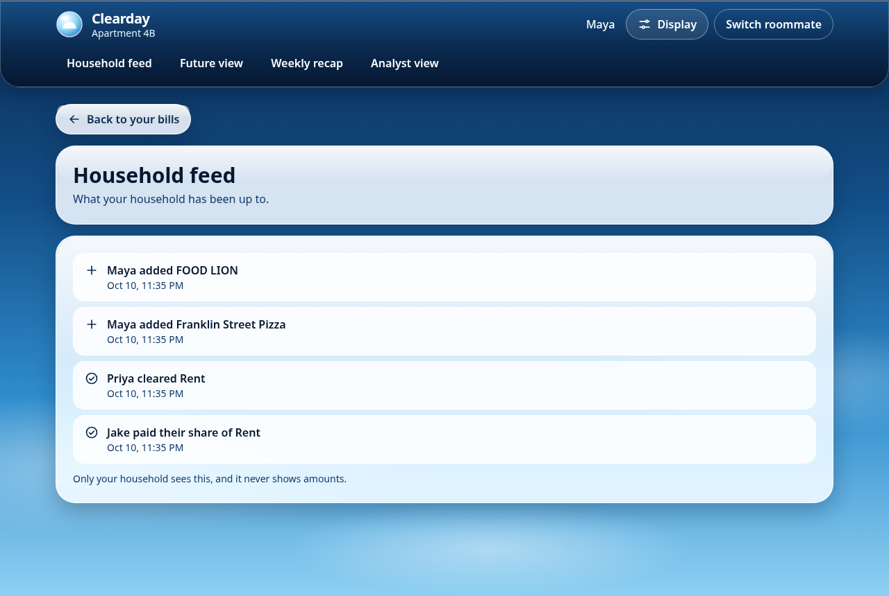
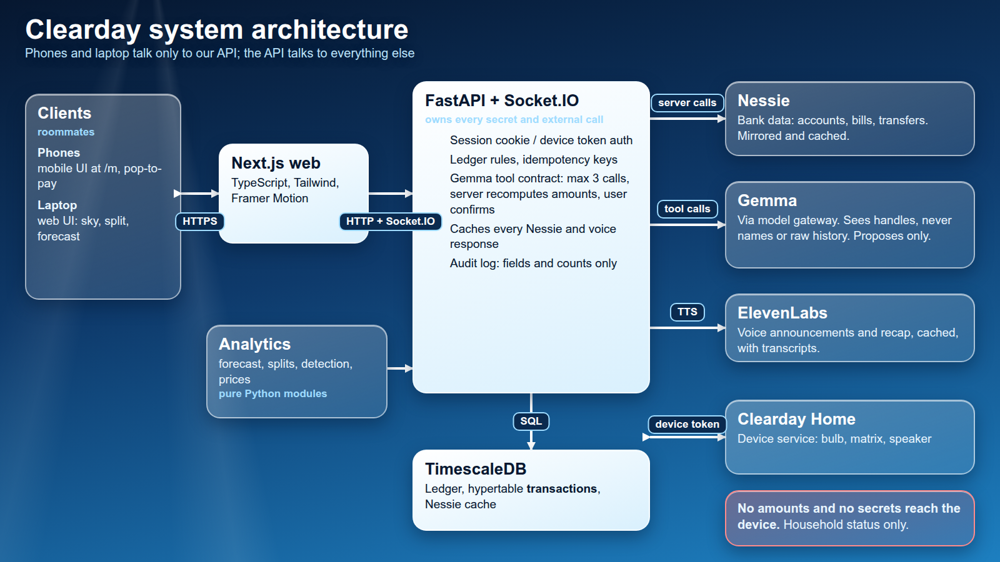
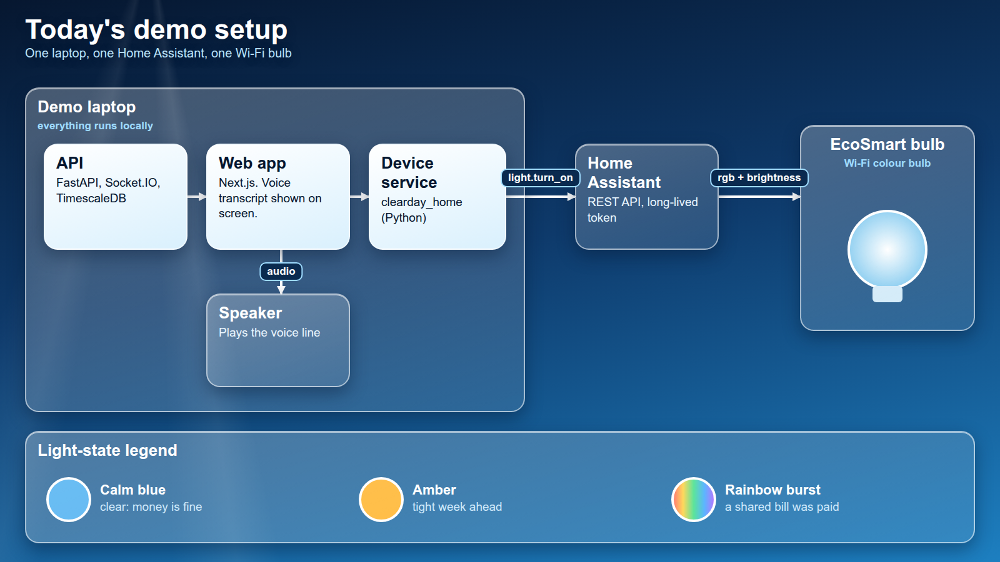
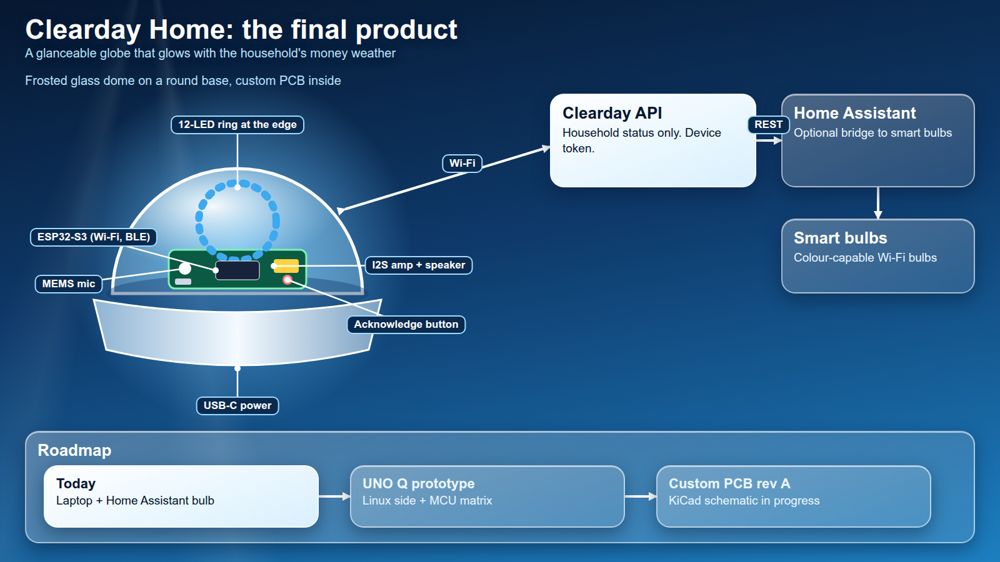
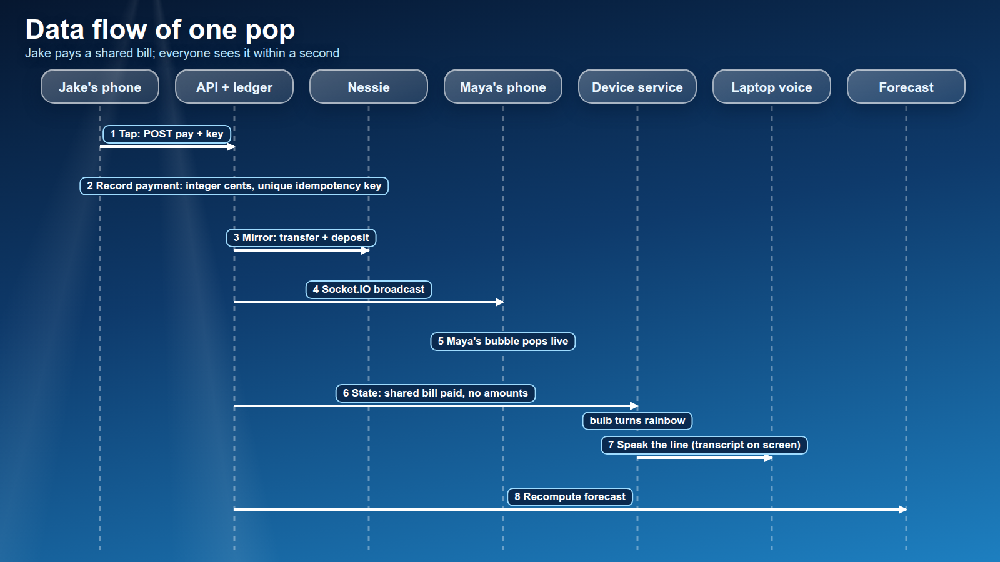

# Clearday

A social money app for roommates, built at HackNC 2026. Upcoming bills float as glossy Frutiger Aero bubbles you pop when they are paid. Shared expenses split through a real ledger and update live for everyone in the household. A Monte Carlo "money weather" forecast warns of tight weeks before they happen, and Clearday Home (an Arduino UNO Q with a smart bulb) reacts to the household in real time.

Clearday is an independent hackathon project. It is not affiliated with or endorsed by Capital One. The demo runs entirely on seeded sandbox and synthetic data.



## What it does

- **The sky.** Each bill is a bubble; height shows how soon it is due and the icon plus label shows whether the forecast says you can cover it. A list view is the screen-reader default.
- **Live shared bubbles.** Rent, electric and internet are shared. Popping a share pays through a Nessie transfer and the ledger; every roommate's screen (and the bulb) updates over Socket.IO.
- **Money weather.** A 30-day forecast with a plain-words chance of dipping below your cushion, safe-to-spend, and a labeled backtest number.
- **Split with words.** "Split last night's pizza with Jake and Priya": Gemma finds the purchase through narrow tools, the server computes every amount, and you confirm.
- **Receipt itemizing and price memory.** Scan a receipt, fix the items, split by item with tax and tip, and see "cheaper before" hints.
- **Also built:** unusual-charge and duplicate-subscription detection, an ElevenLabs household announcement with transcript, a weekly recap, an amount-free private feed, a hypothetical 10-year Future view, a synthetic-household analyst view, and a private opt-in help panel with NC resources.

| Forecast | Split proposal |
| --- | --- |
|  |  |

| Receipt split | List view | Private feed |
| --- | --- | --- |
|  |  |  |

## Architecture

```
web/        Next.js + TypeScript + Tailwind + Framer Motion (responsive)
api/        FastAPI + python-socketio; owns every secret and external call
analytics/  Pure Python modules (forecast, categorize, detection, ...)
device/     Clearday Home: Linux-side Python (bulb, keypad, audio) + MCU sketch (LED matrix)
scripts/    dev.sh, seed_nessie.py, reset_demo.py, demo_rehearsal.py, E2E and audit tooling
docs/       Proposal, technical spec, security, hardware, build plan, demo script
```

- **web** talks only to the API (or an in-memory mock with `NEXT_PUBLIC_USE_MOCKS=1`).
- **api** is the only component that calls Nessie, Gemma and ElevenLabs. Nessie data is cached in the database; the demo reads from the cache.
- **Database:** TimescaleDB, local in podman/Docker (`docker-compose.yml`) for dev and the demo. A Tiger Cloud target (`DB_TARGET=tiger`) exists as an optional backup.
- **device** gets data only from `/api/device/summary` and `/api/household/status`, with a revocable device token. The bulb is driven through Home Assistant.
- **analytics:** `forecast`, `detection`, `backtest` and `synthetic_data` are the stats teammate's real models; `categorize`, `prices`, `cohorts` and `future` are still stubs returning deterministic data behind the exact contract signatures, and `splits` (the ledger math) is real.
- **Hosting:** local only. The demo runs the API, web and database on one laptop.

## Run it

Requires Python 3.12 (installed by bootstrap via uv), Node, and podman-compose or Docker Compose.

```bash
bash scripts/bootstrap.sh          # uv sync, git hooks (idempotent)
cp api/.env.example api/.env       # fill in your own keys; api/.env is gitignored
cp web/.env.example web/.env.local # set NEXT_PUBLIC_USE_MOCKS=0 to use the API
(cd web && npm install)
bash scripts/dev.sh up             # DB, API on :8000, web on :3001 (logs/ has output)
```

Other commands:

```bash
bash scripts/dev.sh status | down | restart
uv run python -m scripts.reset_demo        # return DB and Nessie records to the seeded state
bash scripts/dev.sh rehearse               # cold start, reset, walk every demo beat
uv run pytest && uv run ruff check         # Python tests and lint
(cd web && npm run check)                  # typecheck, lint, format
(cd device && uv sync && uv run pytest)    # device tests
```

`api/.env` holds the Nessie, ElevenLabs and model (Gemma, any OpenAI-compatible endpoint with tool calling) settings. Without a model endpoint the assistant falls back to a template; without ElevenLabs the announcement is text only.

## System design






Sources are in `docs/img/design/`; re-render with `uv run python docs/img/design/render.py`.

## Security and privacy

- **Money is integer cents everywhere.** Leftover cents use the largest-remainder method with ties broken by user ID, and totals reconcile to the cent. Nessie's whole-dollar amounts are converted only at the Nessie client boundary. `scripts/check_money.sh` lints for float money in the pre-commit hook.
- **Identity comes from the session cookie or device token**, never from request bodies or model output. Socket.IO connections without one are rejected.
- **Payments carry a client-generated idempotency key**, enforced by a unique constraint.
- **Model tool contract.** Gemma may call only `find_purchase`, `list_household_members`, `propose_split`, `explain_forecast`, `explain_anomaly` and `read_receipt`, with capped fields, rows and dates and at most 3 calls per request. It never sees raw history, account numbers, Nessie IDs or other people's real names. It proposes; the server recomputes every amount from the ledger; the user confirms. The audit log stores fields and row counts, never values. Merchant names, memos and receipt text are treated as untrusted data.
- **No amounts in the feed or on Clearday Home.** The device speaks household-level information only, without names by default.
- **Receipt images are deleted** right after extraction.
- **Secrets stay in `api/.env`** (gitignored); a pre-commit guard blocks staged secret values. Account views show a nickname and last 4 digits only.
- The analyst view uses synthetic households and hides segments under 20; the Future view is labeled "Hypothetical, not investment advice".

See `docs/03-security-and-privacy.md` for the full rules.

## Accessibility

WCAG AA contrast (audited on glass with axe via `scripts/ui_audit.py`), every bubble state has an icon and a text label, bubbles are real buttons with accessible names, full keyboard access with visible focus, a list view for screen readers, `prefers-reduced-motion` plus an in-app toggle, a text-size control that survives 200% zoom, and transcripts for all audio.

## Credits

- **Nessie**, Capital One's hackathon API, for the sandbox customers, accounts, purchases, bills and transfers.
- **ElevenLabs** for the household announcement and recap voices.
- **Google's Gemma** open model for natural-language splits and receipt reading.
- **TimescaleDB** (Tiger Data) for the time-series database.
- **Home Assistant** for driving the smart bulb.
- Built for HackNC 2026. Palette is inspired by, but not affiliated with, Capital One. All artwork is original.
